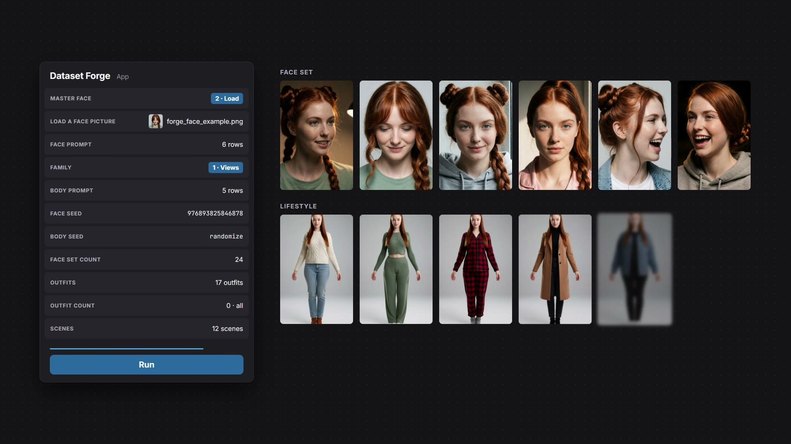
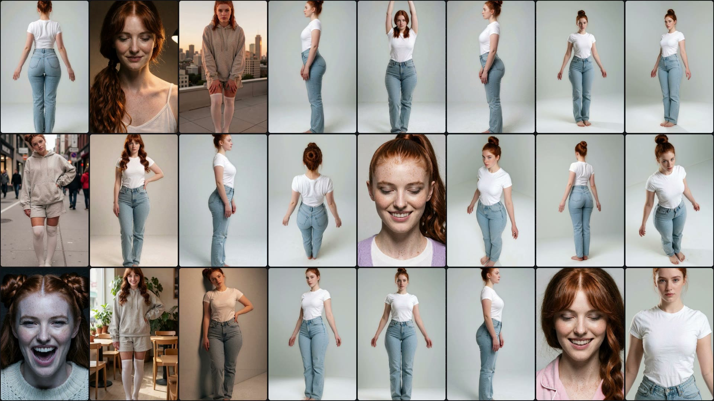

# Dataset Forge

**One face in, a full character LoRA dataset out.** Dataset Forge is a ComfyUI workflow that turns a single face picture into a training set for a character LoRA:
- expressions, hairstyles and lighting on the face
- a full turn around the body from high and low angles
- standing, sitting and kneeling poses
- outfits and scenes for a lifestyle set
- a face pass and a refine pass on every picture

It runs as a **ComfyUI App** with 250 nodes behind 11 inputs. The whole stack is open: every model is open weights, every node pack is open source, and there's no closed API anywhere in the pipeline.

Made for the Comfy *Open Source Higgsfield* challenge. #OpenSourceHiggsfield

## How it works

You fill in the panel and press **Run**. Two runs make a dataset: one with the **Views** family for the angles, and one with a pose family for the body and lifestyle pictures.

| Stage | Models | What it makes |
|---|---|---|
| **1. Master Face** | Krea 2 Turbo | The face, generated from the FACE PROMPT (MASTER FACE = 1) or loaded from your own picture (MASTER FACE = 2) |
| **1. Face Set** | Krea 2 + Identity Edit V2 | The same face with new expressions, hairstyles, lights and tops (FACE SET COUNT pictures) |
| **2. Body Generation** | Krea 2 Turbo | The full body from the BODY PROMPT, in the poses of the chosen FAMILY |
| **2. Angle Set** | Qwen Image 2.1 + Turbo LoRA + QMA camera angles | On a Views run: front, back and both profiles turned into 22 shots around the character, from high, low and eye level |
| **2. Body Set** | Krea 2 + Identity Edit V2 | On a pose run: the family's other poses, with new hairstyles and lights, the body kept |
| **3. Lifestyle** | Flux.2 Klein 9B | The body set dressed in the OUTFITS and placed in the SCENES |
| **4. Face Pass** | Flux.2 Klein 9B + BFS Head + SAM 3.1 | Every picture gets the master face back, using the Face Set picture that best matches its angle and expression |
| **5. Refine** | Krea 2 + BiRefNet + Real-ESRGAN | A last refine pass, then a 1.67x upscale |

Everything is saved under `ComfyUI/output/DatasetForge/` in one folder per stage.

### The panel

| Input | What it does |
|---|---|
| MASTER FACE | 1 = generate the face from the prompt, 2 = load a face picture |
| LOAD A FACE PICTURE | Your face picture (used when MASTER FACE = 2) |
| FACE PROMPT | A Prompt Stack: one idea per row. Name a row, write it, switch it on or off, add new ones |
| FAMILY | Views (for the Angle Set) or a pose family: Standing, Sitting, Knees up, Kneeling, Crouching, Lying side, back or front |
| BODY PROMPT | Who the character is: setting, identity and hair, body, skin and outfit, one row each |
| FACE SEED / BODY SEED | Fixed or random |
| FACE SET COUNT | How many Face Set pictures |
| OUTFITS / OUTFIT COUNT | One outfit per line (`name \| description`); 0 = every line |
| SCENES | One scene per line (`name \| description`). Use at least as many scenes as body pictures |

## Install

1. **ComfyUI 0.43 or newer**, with the App mode frontend. The ComfyUI Desktop app works.
2. **Custom node packs.** Install these from the ComfyUI Manager or by cloning them into `ComfyUI/custom_nodes/`:
   - [ComfyUI-Pixaroma](https://gitlab.com/pixaroma/comfyui-pixaroma) 1.4.241 or newer. It provides Prompt Stack, Load Image Mini, the LoRA loader, Set/Get, Pause, Preview and Remove Background.
   - [ComfyUI-Impact-Pack](https://github.com/ltdrdata/ComfyUI-Impact-Pack) and [ComfyUI-Impact-Subpack](https://github.com/ltdrdata/ComfyUI-Impact-Subpack), for face detection.
   - [ComfyUI-KJNodes](https://github.com/kijai/ComfyUI-KJNodes), for Crop By Mask And Resize.
   - [comfyui-krea2edit](https://github.com/lbouaraba/comfyui-krea2edit), for the Krea 2 identity edit.
   - **ComfyUI-T0x**, included here. Copy `custom_nodes/ComfyUI-T0x` into `ComfyUI/custom_nodes/`. It provides Deal Rows, Choose, For Family, Pick Family, Pick Reference, Pick Size, Pick by Name, Join Lists, Split Row and Release Models.
3. **Models.** These are listed below. Put each file in the folder shown. Subfolders such as `Krea2\` or `qwen\` must match, or you can reselect the file in its loader.
4. **Example pictures.** Copy the `input` folder's contents into `ComfyUI/input/`.
5. Open `workflows/Dataset Forge App.json`, switch to **App** mode and press Run.

Tested on a 12 GB RTX GPU with 32 GB of RAM. Release Models frees each model family before the next stage loads. Expect about 1 minute per Body Set picture and about 45 seconds per Angle Set shot.

## Models

### Base models

| File | Folder | Source |
|---|---|---|
| `krea2_turbo_int8_convrot.safetensors` | `models/diffusion_models/` | [Comfy-Org/Krea-2](https://huggingface.co/Comfy-Org/Krea-2/resolve/main/diffusion_models/krea2_turbo_int8_convrot.safetensors) |
| `qwen_image_2.1_int8_convrot.safetensors` | `models/diffusion_models/qwen/` | [Comfy-Org/Qwen-Image-2.1](https://huggingface.co/Comfy-Org/Qwen-Image-2.1/resolve/main/diffusion_models/qwen_image_2.1_int8_convrot.safetensors) |
| `Flux2-Klein-9B-True-v2-fp8mixed.safetensors` | `models/diffusion_models/` | [wikeeyang/Flux2-Klein-9B-True-V2](https://huggingface.co/wikeeyang/Flux2-Klein-9B-True-V2/resolve/main/Flux2-Klein-9B-True-v2-fp8mixed.safetensors) |
| `qwen3vl_4b_int8_convrot.safetensors` | `models/text_encoders/` | [Comfy-Org/Krea-2](https://huggingface.co/Comfy-Org/Krea-2/resolve/main/text_encoders/qwen3vl_4b_int8_convrot.safetensors) |
| `qwen3vl_8b_int8_convrot.safetensors` | `models/text_encoders/` | [Comfy-Org/Qwen-Image-2.1](https://huggingface.co/Comfy-Org/Qwen-Image-2.1/resolve/main/text_encoders/qwen3vl_8b_int8_convrot.safetensors) |
| `qwen_3_8b_fp8mixed.safetensors` | `models/text_encoders/` | [Comfy-Org/flux2-klein-9B](https://huggingface.co/Comfy-Org/flux2-klein-9B/resolve/main/split_files/text_encoders/qwen_3_8b_fp8mixed.safetensors) |
| `qwen_image_vae.safetensors` | `models/vae/` | [Comfy-Org/Krea-2](https://huggingface.co/Comfy-Org/Krea-2/resolve/main/vae/qwen_image_vae.safetensors) |
| `qwen_image_2.1_vae_bf16.safetensors` | `models/vae/` | [Comfy-Org/Qwen-Image-2.1](https://huggingface.co/Comfy-Org/Qwen-Image-2.1/resolve/main/vae/qwen_image_2.1_vae_bf16.safetensors) |
| `flux2-vae.safetensors` | `models/vae/` | [Comfy-Org/flux2-dev](https://huggingface.co/Comfy-Org/flux2-dev/resolve/main/split_files/vae/flux2-vae.safetensors) |
| `wan_2.1_vae.safetensors` | `models/vae/` | [Comfy-Org/Wan_2.1_ComfyUI_repackaged](https://huggingface.co/Comfy-Org/Wan_2.1_ComfyUI_repackaged/resolve/main/split_files/vae/wan_2.1_vae.safetensors) |
| `sam3.1_multiplex_fp16.safetensors` | `models/checkpoints/` | [Comfy-Org/sam3.1](https://huggingface.co/Comfy-Org/sam3.1/resolve/main/checkpoints/sam3.1_multiplex_fp16.safetensors) |
| `birefnet.safetensors` | `models/background_removal/` | [Comfy-Org/BiRefNet](https://huggingface.co/Comfy-Org/BiRefNet/resolve/main/background_removal/birefnet.safetensors) |
| `face_yolov8m.pt` | `models/ultralytics/bbox/` | [Bingsu/adetailer](https://huggingface.co/Bingsu/adetailer/resolve/main/face_yolov8m.pt) |
| `RealESRGAN_x2plus.pth` | `models/upscale_models/` | [xinntao/Real-ESRGAN](https://github.com/xinntao/Real-ESRGAN/releases/download/v0.2.1/RealESRGAN_x2plus.pth) (BSD-3) |

### Edit and camera LoRAs

| File | Folder | Source |
|---|---|---|
| `krea2_identity_edit_v2.safetensors` | `models/loras/Krea2/` | [conradlocke/krea2-identity-edit](https://huggingface.co/conradlocke/krea2-identity-edit/resolve/main/krea2_identity_edit_v2.safetensors) |
| `qwen_image_2.1_turbo_lora_avg_rank_178_bf16.safetensors` | `models/loras/qwen2.1/` | [Comfy-Org/Qwen-Image-2.1](https://huggingface.co/Comfy-Org/Qwen-Image-2.1/resolve/main/loras/qwen_image_2.1_turbo_lora_avg_rank_178_bf16.safetensors) |
| `qwen-image-2.1-qma-camera-angles.safetensors` | `models/loras/qwen2.1/` | [gribbliest/qwen-image-2.1-qma-camera-angles](https://huggingface.co/gribbliest/qwen-image-2.1-qma-camera-angles/resolve/main/qwen-image-2.1-qma-camera-angles.safetensors) |
| `bfs_head_v1_flux-klein_9b_step3500_rank128.safetensors` | `models/loras/Flux2Klein/` | [Alissonerdx/BFS-Best-Face-Swap](https://huggingface.co/Alissonerdx/BFS-Best-Face-Swap) |

### Character LoRAs (Krea 2, in `models/loras/Krea2/`)

These sliders shape the face and body. They can all be switched off or set to 0 in the two Pixaroma LoRA loaders, and every one is optional.

| File | Used for | Source |
|---|---|---|
| `head_size_krea2_loraholic.safetensors` | Face, body | [Head Size Slider](https://civitai.com/models/2785479?modelVersionId=3138325) |
| `age_krea2_loraholic.safetensors` | Face, body | [Age slider](https://civitai.com/models/2533032?modelVersionId=3067659) |
| `hair_volume_krea2_loraholic.safetensors` | Face | [Hair Volume Slider](https://civitai.com/models/2541071?modelVersionId=3152350) |
| `Beauty_Eyes_Enhancer_-_Krea2_2_krea2_3272782_epoch_10.safetensors` | Face | [Beauty Enhancer + Realistic eyes](https://civitai.com/models/1397935?modelVersionId=3275295) |
| `skintone_v2_krea2_loraholic.safetensors` | Face, body | [Skin Tone Slider](https://civitai.com/models/2540631?modelVersionId=3187970) |
| `detail_slider_krea2_loraholic.safetensors` | Face | [Detail Slider](https://civitai.com/models/2772451?modelVersionId=3121642) |
| `famegrid_krea2_standard.safetensors` | Face, body | [Famegrid realism](https://civitai.com/models/2088956?modelVersionId=3154245) |
| `breast_size_v2_krea2_loraholic.safetensors` | Body | [Breast Size Slider](https://civitai.com/models/2540187?modelVersionId=3131773) |
| `breast_fake_real_krea2_loraholic.safetensors` | Body | [Real / Fake Slider](https://civitai.com/models/2554586?modelVersionId=3192618) |
| `areola_size_krea2_loraholic.safetensors` | Body | [Areola Size Slider](https://civitai.com/models/2554618?modelVersionId=3120387) |
| `slimthick_b5_12_highgain-rounded.safetensors` | Body | [BodyMod, Slim Round](https://civitai.com/models/2941932?modelVersionId=3330897) |

## The example

`input/forge_face_example.png` is the face from the video. `input/forge_body_example.png` is a body master you can load instead of generating one. `input/Dataset Forge Faces/` holds three faces for the picker.

All pictures are AI-generated. The character is fictional and is not based on a real person.

## Licence

[MIT](LICENSE) covers the workflow, the ComfyUI-T0x node pack and the example pictures. The models and the other node packs keep their own licences.
